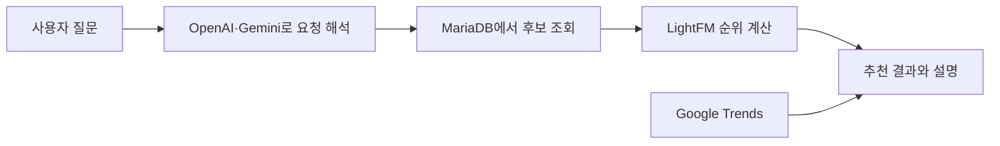

# BeautyLens

Sephora 상품·리뷰 데이터로 사용 이력이 없는 사용자에게 스킨케어 상품을 추천하는 프로젝트다. 피부 타입과 원하는 제품을 입력하면 조건에 맞는 후보를 찾고, LightFM으로 순위를 계산한다.

처음에는 자연어 추천 서비스를 구현했고, 이후 코드에서 반복되는 처리를 줄이고 신규 사용자 기준으로 모델을 다시 평가했다. 수정한 코드와 실험은 `optimized/`에 모았다.

## 모델 비교 결과

원본 노트북의 30회 학습 설정을 같은 학습 사용자로 다시 학습해 비교했다. 테스트는 학습에 참여하지 않은 사용자 10,000명이며, 후보 상품과 정답도 두 모델에 동일하게 적용했다.

| 모델 | Precision@10 | Recall@10 | NDCG@10 |
|---|---:|---:|---:|
| 원본 설정 재학습 | 0.01933 | 0.10441 | 0.06200 |
| 개선 프로필 LightFM | 0.02178 | 0.13324 | 0.08388 |

NDCG@10은 원본 설정 대비 약 35.3% 높아졌다. 전처리와 학습 구성을 함께 바꾼 결과라, 어느 한 변경만의 효과로 보기는 어렵다.

부정 리뷰를 함께 학습한 모델은 성능이 낮아 제외했다. 추천 목록을 재정렬하는 실험에서는 평균 브랜드 수가 7.70개에서 9.41개로 늘었지만, 정확도와 전체 상품 노출 범위는 개선되지 않았다.

[실험 결과와 한계](optimized/portfolio/FINAL_REPORT.md) · [모델 비교 노트북](optimized/cold_start_benchmark/model_comparison.ipynb)

## 현재 코드 상태

**자연어 추천 서비스는 아직 기존 모델을 사용한다.** 새 모델은 비교 데모에서 실행할 수 있다. 위 성능 수치는 신규 사용자 오프라인 평가 결과다.

| 경로 | 내용 |
|---|---|
| `src/`, `streamlit/`, `airflow/` | 원본 서비스 |
| `optimized/src/`, `optimized/streamlit/` | 모델 캐시·조회 처리·화면을 수정한 서비스 |
| `optimized/cold_start_benchmark/` | 데이터 정제, 사용자 분리, 모델 비교, 원본 설정 재현 |
| `optimized/cold_start_improvements/` | 부정 리뷰 학습과 다양성 실험 |
| `optimized/portfolio/` | 원본·개선 모델 비교 화면, 실행 안내, 결과 문서 |

서비스 코드에서 바꾼 부분은 [optimized README](optimized/README.md)에 정리했다.

## 추천 흐름



LLM은 요청을 해석하고 결과를 설명한다. DB 안의 상품 순위는 LightFM이 계산한다. 모델이 지원하지 않는 후보는 평점·리뷰 수로 대체 순위를 만들고, DB에 후보 자체가 없으면 웹 검색을 시도한다. Google Trends는 추천 점수와 분리해서 보여준다.

S3는 상품·리뷰·성분 처리 파일을 저장하는 데 사용한다. Airflow는 이 파일을 정제해 DB에 적재한다. 데이터가 준비된 뒤에는 로컬 DB와 모델로 추천할 수 있어, 로컬 실행에 EC2가 필요하지는 않다.

## 실행

Python 3.11.9에서 확인했다. API 키, 데이터, DB 내용, 학습 모델은 저장소에 포함하지 않았다. 아래 명령을 실행하기 전에 각 준비물을 갖춰야 한다.

### 모델 비교 데모

저장된 원본·개선 모델, 상품 feature, 선택 설정이 필요하다. DB나 외부 API는 사용하지 않는다. 필요한 파일 목록과 설치 순서는 [데모 README](optimized/portfolio/README.md)에 있다.

프로젝트 루트에서:

```powershell
python -m streamlit run optimized/portfolio/app.py --server.address 127.0.0.1 --server.port 8502 --server.headless true --browser.gatherUsageStats false
```

`http://127.0.0.1:8502`에서 프로필·제품 종류·예산을 입력해 두 모델의 추천을 비교할 수 있다.

### 자연어 추천 서비스

MariaDB의 상품·성분 데이터, 기존 `models/sephora_hybrid_lightfm.joblib`, OpenAI·Gemini 설정이 필요하다. `.env.example`을 참고해 본인 환경의 `.env`를 작성한다.

```powershell
python -m venv .venv-service
$servicePython = (Resolve-Path '.venv-service\Scripts\python.exe').Path
& $servicePython -m pip install -r optimized/requirements.txt
& $servicePython -m uvicorn optimized.src.api.main:app --host 127.0.0.1 --port 8001
```

다른 터미널에서 화면을 실행한다.

```powershell
$servicePython = (Resolve-Path '.venv-service\Scripts\python.exe').Path
$env:RECOMMEND_API_URL = 'http://127.0.0.1:8001/chat/recommend'
& $servicePython -m streamlit run optimized/streamlit/streamlit.py --server.address 127.0.0.1 --server.port 8503 --server.headless true --browser.gatherUsageStats false
```

화면 주소는 `http://127.0.0.1:8503`이다. `/health`는 API가 응답하는지만 확인한다.

### 패키지와 재학습

서비스는 `lightfm==1.17`, 새 모델 실험은 `lightfm-next==1.19.0`을 사용한다. 두 패키지는 import 이름이 같아 실험에서는 별도 `.packages` 경로를 사용했다. 서비스 설치와 실험 설치는 아래 안내대로 구분한다.

- [서비스 수정 및 실행](optimized/README.md)
- [모델 실험과 Windows 빌드](optimized/cold_start_benchmark/README.md)
- [전체 재학습 순서](optimized/portfolio/README.md#3-전체-학습을-다시-실행하려면)

Windows에서 LightFM을 소스 빌드하려면 C/C++ 빌드 도구가 필요할 수 있다. 새 실험의 WARP 학습에는 문서에 적은 수정 빌드가 필요하다. 새 모델은 저장 구조도 달라 기존 서비스 모델 파일에 덮어쓰는 것으로 연결되지는 않는다.

## 검증

서비스 회귀 테스트와 모델 평가 테스트는 외부 API·S3를 호출하지 않고 실행한다.

```powershell
python -m unittest discover -s optimized/tests -v
python -m unittest optimized.cold_start_benchmark.test_experiment optimized.cold_start_improvements.test_improvements -v
```

서비스·화면 테스트 11개, 모델 평가 테스트 14개가 통과했다. 저장된 모델까지 확인하는 `python -m optimized.portfolio.verify`는 [데모 준비물](optimized/portfolio/README.md)을 갖춘 뒤 실행한다. 새 환경 설치나 전체 재학습을 문서 수정 때마다 반복한 것은 아니다.

## 남은 부분

네 개 프로필과 조건이 같으면 같은 추천을 받는다. 피부 고민·제형 취향을 직접 학습할 데이터는 아직 없다. 리뷰 작성자를 대상으로 한 한 번의 사용자 분리 평가라, 실제 신규 가입자 반응과 여러 seed에서의 안정성도 더 확인해야 한다.

상품 쏠림과 새 모델의 서비스 연결도 남아 있다. 초기 구현과 과거 평가 수치는 [이전 README](https://github.com/KMINNNNJ/recommendation_system/blob/8058c866bc44a9cbccce0d60532502c91aa310b4/README.md)에 보존했다. 당시 무작위 리뷰 분할 수치는 이번 신규 사용자 평가와 직접 비교하지 않는다.
