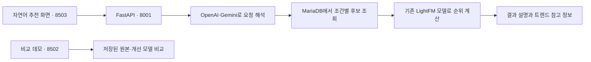

# BeautyLens · 신규 사용자 스킨케어 추천

Sephora 상품·리뷰 데이터를 바탕으로 사용 이력이 없는 사용자에게 스킨케어 상품을 추천하는 프로젝트입니다. 기존 서비스 코드의 처리 효율 개선과 신규 사용자 모델 실험을 `optimized/`에서 별도로 진행했습니다.

## 먼저 보기

- **성과와 한계:** [최종 결과 보고서](optimized/portfolio/FINAL_REPORT.md)
- **직접 실행:** [원본·개선 모델 비교 데모](optimized/portfolio/README.md)
- **구현 변경:** [서비스 개선 코드와 검증](optimized/README.md)

프로젝트의 핵심은 이력이 없는 사용자에게 맞는 평가를 설계하고, 원본 학습 설정을 같은 조건에서 재현하여 비교한 것입니다. 신규 사용자 NDCG@10을 약 35% 개선했으며, 효과가 없었던 부정 리뷰 모델과 상품 쏠림 문제도 결과에 포함했습니다.

## 현재 상태

**새 모델의 서비스 적용은 아직 하지 않았습니다.** 자연어 추천 화면은 기존 LightFM 모델을 사용하고, 비교 데모는 기존 모델과 새 개선 모델의 결과를 나란히 보여줍니다. 아래 약 35% 향상은 신규 사용자 오프라인 평가 결과이며 실제 서비스 만족도 향상을 의미하지 않습니다.

| 구성 | 위치 | 사용하는 모델 / 역할 |
|---|---|---|
| 원본 서비스 | `src/`, `streamlit/`, `airflow/` | 기존 코드 보존 |
| 서비스 개선본 | `optimized/src/`, `optimized/streamlit/` | 기존 모델 유지, 로딩 캐시·조회 처리 및 화면 개선 |
| 신규 사용자 실험 | `optimized/cold_start_benchmark/` | 사용자 분리·8개 설정 비교·원본 학습 설정 재현 |
| 후속 실험 | `optimized/cold_start_improvements/` | 부정 리뷰 학습·조건별 평가·다양성 재정렬 |
| 포트폴리오 데모 | `optimized/portfolio/` | 원본 설정 재학습 모델과 개선 학습 모델 비교 |

이 변경은 원본 코드를 보존하고 `optimized/`를 추가하는 방식입니다. 서비스 개선본 화면에는 답변 글자 대비 보정, 처리 중 안내, 완료·시간 초과·연결 실패 표시를 적용했습니다. 코드 공개와 로컬 실행까지의 범위이며 클라우드 공개 배포는 수행하지 않았습니다.

## 추천 서비스와 모델 실험의 관계



OpenAI·Gemini는 요청 해석과 설명을 담당하고 LightFM이 후보의 순위를 계산합니다. DB 후보가 없거나 모델 지원 범위에 없는 경우에는 기존 서비스의 카탈로그·웹 검색 대체 경로가 적용됩니다. Google Trends는 순위와 별개인 관심도 참고 정보입니다.

AWS S3는 상품·리뷰·성분 처리 파일을 저장하는 데이터 준비 단계에서 사용합니다. 현재 로컬 추천은 DB와 모델을 읽어 실행하며, EC2를 새로 만들지 않아도 확인할 수 있습니다. S3 적재와 Airflow 실행은 추천 화면 실행과 별도로 설정합니다.

## 결과

동일한 신규 사용자 10,000명, 동일 후보·정답에서 원본 노트북의 30회 학습 설정을 공통 학습 사용자로 재학습한 결과와 비교했습니다.

| 설정 | Precision@10 | Recall@10 | NDCG@10 |
|---|---:|---:|---:|
| 원본 설정 재학습 | 0.01933 | 0.10441 | 0.06200 |
| 개선 프로필 LightFM | 0.02178 | 0.13324 | 0.08388 |

NDCG@10 상대 향상은 약 **35.3%**입니다. 전처리·특징·학습 설정의 여러 변경이 합쳐진 결과이며, 온라인 만족도 향상을 측정한 것은 아닙니다. 후속 재정렬은 브랜드 중복을 줄였지만 정확도와 전체 상품 노출 범위 개선은 확인하지 못했습니다.

- [최종 결과와 한계](optimized/portfolio/FINAL_REPORT.md)
- [발표·면접 설명 예시](optimized/portfolio/PRESENTATION.md)

## 설치 환경을 구분하세요

검증한 Python은 **3.11.9**입니다.

| 실행 목적 | 설치 목록 | LightFM 패키지 |
|---|---|---|
| 기존 서비스 / 서비스 개선본 | `requirements.txt` 또는 `optimized/requirements.txt` | `lightfm==1.17` |
| 신규 사용자 전체 모델 실험 | `optimized/cold_start_benchmark/requirements.txt` | `lightfm-next==1.19.0`, 실험 전용 `.packages` |
| 저장 모델 비교 데모 | `optimized/portfolio/requirements.txt` 및 데모 안내의 LightFM 준비 | 저장된 실험 모델을 읽는 데 필요한 런타임 |

`lightfm`과 `lightfm-next`는 서로 다른 배포 패키지지만 모두 Python에서는 `lightfm`으로 import합니다. 각 안내대로 설치하고 같은 환경에 두 배포판을 무작정 함께 설치하지 마세요. Windows의 신규 실험 WARP 재학습에는 MSVC와 [전용 수정 빌드](optimized/cold_start_benchmark/README.md#windows-lightfm-실행-수정)가 필요합니다. 저장 모델 추론 확인은 재학습 빌드 검증을 대신하지 않습니다.

## 코드만 clone하면 바로 실행되지는 않습니다

비밀키, 원본 데이터, DB 내용, 학습 모델, 실행별 `artifacts/`는 Git에 포함하지 않습니다. 공개 문서에는 집계 결과를 남겼습니다. 상세 결과·그래프에 대한 일부 링크는 로컬 산출물용이므로 GitHub에서는 해당 파일이 없을 수 있습니다.

### 1. 비교 데모

API 키·DB·S3 없이 실행하지만 **저장된 원본/개선 모델과 상품 feature, 선택 설정**이 필요합니다. 파일별 경로와 재학습 순서는 [데모 실행 안내](optimized/portfolio/README.md)에 있습니다. 코드만으로 모델이 자동 다운로드되지는 않습니다.

현재 준비된 PC에서는:

```powershell
& .\optimized\portfolio\run_demo.ps1
```

기본 주소는 `http://127.0.0.1:8502`입니다. 스크립트의 Python 경로가 다르면 `-PythonPath`를 지정하세요.

### 2. 기존 서비스 개선본

다음 준비물이 필요합니다.

- 상품·성분·상품-성분 연결 데이터가 적재된 MariaDB
- 기존 서비스용 `models/sephora_hybrid_lightfm.joblib`
- 본인 환경의 `.env`: DB 연결과 OpenAI/Gemini 키·접근 가능한 모델명
- 데이터 준비 파이프라인을 실행한다면 별도의 S3·AWS 자격 증명 설정

프로젝트 루트에서 Python 3.11 가상환경을 준비하고 실행합니다. Windows에서 원본 LightFM을 소스 빌드하는 환경에는 C/C++ 빌드 도구가 필요할 수 있습니다.

```powershell
python -m venv .venv-service
$servicePython = (Resolve-Path '.venv-service\Scripts\python.exe').Path
& $servicePython -m pip install -r optimized/requirements.txt

# .env가 아직 없는 새 checkout에서만 템플릿을 복사합니다.
if (-not (Test-Path -LiteralPath '.env')) {
    Copy-Item -LiteralPath '.env.example' -Destination '.env'
}
# 실행 전 .env의 빈 항목을 본인 설정으로 채우세요.
& $servicePython -m uvicorn optimized.src.api.main:app --host 127.0.0.1 --port 8001
```

다른 터미널에서:

```powershell
$servicePython = (Resolve-Path '.venv-service\Scripts\python.exe').Path
$env:RECOMMEND_API_URL = 'http://127.0.0.1:8001/chat/recommend'
& $servicePython -m streamlit run optimized/streamlit/streamlit.py --server.address 127.0.0.1 --server.port 8503 --server.headless true --browser.gatherUsageStats false
```

API는 `http://127.0.0.1:8001`, 화면은 `http://127.0.0.1:8503`입니다. `/health`는 API의 응답 여부만 확인하며 DB·S3·LLM 전체 연동을 보장하지 않습니다. EC2는 로컬 실행에 필수가 아닙니다.

원본과 신규 학습 모델은 저장 구조가 다르므로 신규 체크포인트를 기존 모델 경로에 단순 덮어쓰지 마세요. 서비스에 새 모델을 적용하는 어댑터 작업은 별도 범위입니다.

## 검증과 재학습

- [서비스 코드 변경 설명 및 회귀 검증](optimized/README.md)
- [신규 사용자 모델 실험](optimized/cold_start_benchmark/README.md)
- [부정 리뷰·다양성 실험](optimized/cold_start_improvements/README.md)
- [데모 설치·검증·전체 재학습 순서](optimized/portfolio/README.md)

현재 PC에서 코드와 저장 모델을 검증했습니다. 이 안내를 작성하면서 새 가상환경 설치나 전체 데이터 재학습을 다시 실행하지는 않았습니다.

서비스 코드의 회귀 검증과 화면 성공·시간 초과·S3 설정 누락 처리는 다음 명령으로 확인할 수 있습니다. 외부 API 호출이나 실제 S3 적재 없이 실행하는 테스트입니다.

```powershell
& $servicePython -m unittest discover -s optimized/tests -v
```

학습 모델·데모까지 확인하려면 필요한 산출물을 준비한 후 별도 실험 환경에서 `python -m optimized.portfolio.verify`를 실행하세요. 데이터와 모델은 GitHub에서 자동 제공하지 않습니다.

## 이전 문서와 평가 기록

초기 프로토타입의 데이터 흐름·DB·배포 설명은 [이전 README 기록](https://github.com/KMINNNNJ/recommendation_system/blob/8058c866bc44a9cbccce0d60532502c91aa310b4/README.md)에 보존했습니다. 해당 문서의 Precision·Recall·AUC 향상은 초기 노트북의 무작위 리뷰 분할 결과입니다. 이 문서의 신규 사용자 분리 평가와는 평가 조건이 다르므로 향상률을 직접 비교하지 않습니다.
