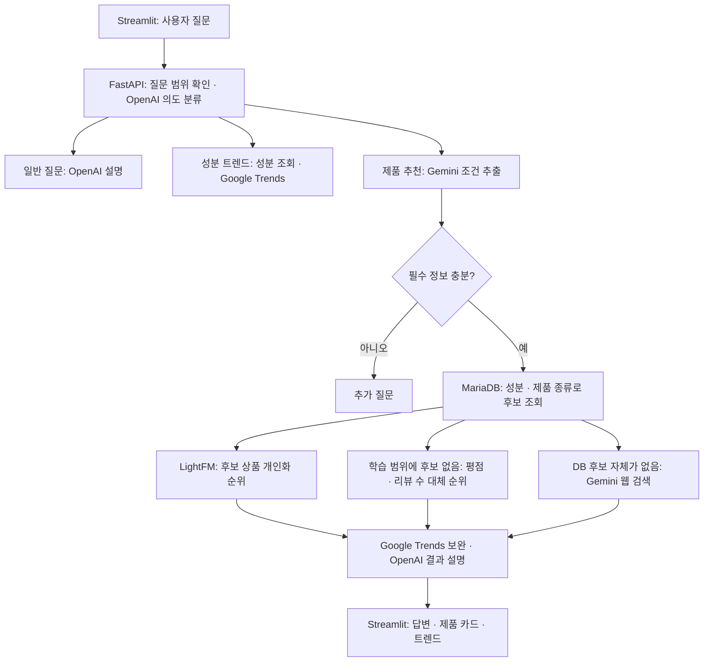

# 코드 구조 설명과 별도 개선본

## 현재 적용 범위와 설치 환경

- `optimized/src`와 `optimized/streamlit`은 기존 서비스 코드의 개선본이며, **기존 `models/sephora_hybrid_lightfm.joblib`을 사용합니다.**
- NDCG@10이 원본 설정 재학습 대비 약 35% 향상된 신규 사용자 모델은 `cold_start_benchmark`와 `portfolio` 비교 데모에서 사용합니다. **기존 서비스 API에는 아직 연결하지 않았습니다.**
- 기존 서비스 설치는 루트 또는 이 폴더의 `requirements.txt`를 사용합니다. 패키지는 `lightfm==1.17`이며 Streamlit은 검증한 `1.63.0`으로 고정했습니다.
- 새 모델 실험은 `cold_start_benchmark/requirements.txt`의 **`lightfm-next==1.19.0`** 및 실험 전용 `.packages`를 사용합니다. 두 패키지 모두 Python에서는 `lightfm`으로 import하므로 같은 설치 대상으로 섞지 마세요. Windows 학습 수정 빌드는 [실험 안내](cold_start_benchmark/README.md#windows-lightfm-실행-수정)를 따릅니다.
- `.env`, 원본 데이터, 모델과 실행별 산출물은 Git에 포함하지 않습니다. 코드만 clone하면 실행되지 않으며, 서비스에는 DB·키·기존 모델이, 비교 데모에는 저장된 실험 산출물이 필요합니다. [프로젝트 실행 안내](../README.md)와 [데모 준비물](portfolio/README.md)을 확인하세요.
- 공개용 개선 DAG의 S3 버킷은 `S3_BUCKET_NAME`으로 명시해야 합니다. 개인 버킷 이름을 기본값으로 두지 않으며, 누락 시 S3 요청 전에 설정 오류를 반환합니다.

## 신규 사용자 모델링 추가

신규 사용자 대상 전처리·사용자 분리·모델 비교는 [cold_start_benchmark/README.md](cold_start_benchmark/README.md)에 있습니다. 직접 조회할 노트북은 [model_comparison.ipynb](cold_start_benchmark/model_comparison.ipynb), 최종 실험 결과는 `cold_start_benchmark/artifacts/cold_users_v2/`에 저장합니다. 아래 본문은 기존 서비스 코드의 성능 개선에 관한 설명입니다.

후속 개선 실험인 **조건별 추천·다양성 재정렬·부정 리뷰 학습 비교**는 [cold_start_improvements/README.md](cold_start_improvements/README.md)에 있습니다. 기존 모델과 데이터를 재사용하며 새 코드와 결과는 `cold_start_improvements/`에 따로 저장합니다.

포트폴리오용 **원본·개선 추천 비교 데모, 실행/재학습 안내, 최종 결과와 발표 요약**은 [portfolio/README.md](portfolio/README.md)에 모았습니다. 데모 실행은 `portfolio/run_demo.ps1`이며 기존 서비스와 별도로 로컬 8502 포트를 사용합니다.

이 폴더는 원본의 Python 코드를 복사한 개선본입니다. 원본 `src`, `airflow/dags`, `streamlit`은 보존했습니다. 루트와 이 폴더의 `requirements.txt`는 배포 준비 과정에서 잘못된 LightFM 버전 지정을 수정하고 Streamlit 버전을 고정했습니다. 기존 데이터·모델·비밀키·로그를 복사하지 않았습니다.

## 1. 이 프로젝트가 하는 일

Sephora 상품·리뷰와 성분 사전을 이용한 화장품 추천 서비스입니다. 사용자의 자연어에서 추천 조건을 추출하고, DB에서 조건에 맞는 후보를 찾은 다음, 이미 학습된 LightFM 모델로 순위를 계산합니다. Google Trends와 Gemini의 Google Search는 보조 정보를 제공합니다.



### 화면과 API

- `streamlit/streamlit.py`: 입력, 대화 기록, 추가 질문 상태, 제품 카드와 트렌드 표시를 담당합니다. 정보가 부족하면 이전 질문에 새 정보를 덧붙여 다시 전송합니다. 이 상태는 Streamlit 세션에 저장됩니다.
- `src/api/main.py`: `/health`, `/recommend`, `/chat/recommend`를 제공합니다. `/recommend`는 성분·프로필을 직접 받으며, `/chat/recommend`는 자연어를 받습니다. 먼저 키워드로 서비스 범위를 확인하고 OpenAI로 일반 질문·제품 추천·성분 트렌드로 분류합니다. 최종 추천 결과 설명도 OpenAI가 작성합니다.

### 조건 추출과 후보 선택

- `src/cosmetics/query/user_query_parser.py`: Gemini가 피부 타입, 고민, 성분, 제품 종류 등을 JSON으로 추출합니다. 이후 코드가 한글·영문 값을 정규화하고 누락 정보를 판정합니다. 제품 종류가 빠졌으면 추가 질문을 합니다.
- `src/cosmetics/ingredients/ingredient_repository.py`: 추천을 조정하는 중심 파일입니다. 성분 키·영문명·한글명·동의어를 조회하고, `products`와 `product_ingredients`를 연결해 성분 함유 후보를 찾습니다. 제품 종류는 이름과 카테고리의 키워드로 필터링합니다.
- 성분을 직접 말하지 않은 스킨케어 요청은 코드에 정의된 피부 타입·고민별 성분 목록을 순서대로 시도합니다. 이 성분 선택은 규칙 기반입니다. 개인별로 학습된 성분 선택 모델은 아닙니다.
- 커버력·지속력 같은 성능 중심 요청은 별도 경로로 처리합니다. 성분을 임의로 고르지 않고 제품 종류로 후보를 찾습니다. 현재 데이터에는 직접적인 성능 측정값이 없어서 모델 점수가 해당 성능을 입증하지 않습니다.

### LightFM 순위 계산

`src/recommendation/sephora_lightfm.py`는 `models/sephora_hybrid_lightfm.joblib`을 읽습니다. 모델 묶음에는 학습된 모델, 사용자·상품 ID 매핑, feature 매핑과 상품 feature 행렬이 들어 있습니다.

새 사용자는 피부 타입·피부톤·눈 색상·머리 색상을 `skin_type:oily` 같은 토큰으로 변환합니다. 학습 사전에 없는 값은 대응하는 `unknown` 토큰으로 대체합니다. 사용 가능한 토큰에 동일한 가중치를 주어 한 행짜리 희소행렬을 만들고, DB에서 얻은 후보 중 모델이 아는 상품만 `predict()`에 전달합니다. 그 점수로 상위 N개를 고릅니다.

LLM은 추천 조건을 해석하고 계산 결과를 설명합니다. DB 상품의 개인화 순위는 LightFM이 정합니다. 상품이 DB에는 있지만 모델 매핑에 없으면 평점·리뷰 수를 사용한 베이지안 대체 순위를 제공합니다. DB 후보가 아예 없으면 Gemini와 Google Search로 외부 제품을 탐색합니다. 결과의 `ranking_method`가 이 경로를 구분합니다.

### 트렌드

- `src/cosmetics/trends/google_trends_collector.py`: 한국의 최근 12개월 관심도를 조회하고 최근 4주와 직전 4주 평균을 비교합니다. 값은 검색 건수가 아닌 상대 관심도 지수입니다. 기존 코드도 다운로드 시 디스크 캐시를 사용합니다.
- `src/cosmetics/trends/product_trend_collector.py`: Gemini의 Google Search 결과에서 제품과 출처를 추출합니다. 현재 추천 경로에서는 주로 DB 후보가 없는 경우의 웹 대체 검색에 사용합니다. `get_trending_products()` 함수는 존재하지만 현재 repository의 추천 응답은 `trending_products=[]`를 반환합니다.

## 2. 데이터를 준비하는 코드

온라인 추천과 데이터 준비는 서로 다른 작업입니다.

| 위치 | 역할 |
|---|---|
| `airflow/dags/ingredient_pipeline.py` | S3 상품 CSV → 성분 파싱 → 정제·의심 데이터 분리 → 상품·성분·연결 테이블 적재 |
| `airflow/dags/review_pipeline.py` | S3 리뷰 CSV → 리뷰 정제 → 사용자-상품 상호작용 생성 → 검증 → MariaDB 적재 |
| `src/cosmetics/ingredients/ingredient_extractor.py` | 상품 성분 문자열 파싱, 표준 키 생성, 등장 통계 |
| `ingredient_dictionary_builder.py` | 식약처 성분 정보와 연결하는 사전 생성 |
| `ingredient_regulation_filter.py` | 규제 정보 결합과 추천 가능·추가 검토 여부 표시 |
| `ingredient_candidate_selector.py` | 필터링된 성분 사전과 제품 데이터를 이용한 후보 통계·점수 산출 |
| `src/database/load_*.py` | S3 데이터를 MariaDB에 적재하는 개별 실행 스크립트 |
| `src/database/check_sephora_product_urls.py` | Sephora 사이트맵의 제품 URL과 DB 상품 ID 연결 |

리뷰 파이프라인은 사용자·상품별 평균 평점, 리뷰 수, 추천 비율 등을 집계합니다. 현재 `interaction_score`는 평균 평점 그대로입니다. 조회한 코드에는 LightFM 학습 스크립트가 없으며, 저장된 모델을 불러오는 추론 코드만 있습니다. 따라서 Airflow ETL 실행만으로 모델이 자동 재학습된다고 볼 수 없습니다.

규제 필터가 만드는 정보와 온라인 조회 조건도 구분해야 합니다. 현재 `resolve_ingredient()`는 `recommendable` 등을 읽지만 이를 반환하거나 거부 조건으로 사용하지 않습니다. 규제 정보가 있다는 사실만으로 API가 모든 규제 조건을 강제한다고 볼 수 없습니다. 이번 개선본은 기존 추천 정책을 유지했습니다.

## 3. 개선한 부분

| 부분 | 원본 | 개선본 |
|---|---|---|
| 모델 로딩 | 추천 호출마다 약 87MB 파일 역직렬화 | 프로세스별 한 번 로딩 후 재사용 |
| 모델 갱신 | 호출마다 다시 로딩 | 파일 경로·수정 시각·크기 변경 시 다시 로딩, 명시적 캐시 초기화 지원 |
| 동시 첫 요청 | 각 요청이 파일 로딩 | 잠금으로 초기 로딩 중복 방지 |
| 상위 N개 선정 | 후보 전체에 결과 객체를 만들고 정렬 | `heapq.nlargest`로 상위 후보만 선정; 동점 순서 유지 |
| 제품 종류 필터 | 행별 문자열 합치기, 키워드별 반복 검색 | 열별 문자열 합치기, 하나의 정규식으로 검색 |
| Airflow DB 적재 | `iterrows()`로 행마다 Series 생성 | 필요한 열만 `itertuples()`로 읽어 배치 삽입 |
| 실행 경로 | 원본 `src` import | `optimized.src` import로 개선본 경로 명확화 |
| 화면 연결 | API 8000 포트 고정 | 기본 8001 포트, 환경변수로 변경 가능 |

모델 캐시는 프로세스마다 별도이며 모델 객체를 읽기 전용으로 취급합니다. 파일 내용만 변경하고 크기·수정 시각을 동일하게 보존한 경우에는 `clear_model_cache()` 또는 서버 재시작이 필요합니다. NaN·무한대 점수와 음수 슬라이스는 기존 정렬 경로를 유지합니다.

`itertuples()`는 혼합 숫자 열을 읽을 때 큰 정수 ID가 실수로 변환되는 `iterrows()`의 문제도 피합니다. 결측값을 DB의 NULL로 바꾸는 처리와 삽입 열 순서·배치 크기는 유지했습니다.

## 4. 실행 방법

아래 명령은 **원래 프로젝트 루트**에서 실행합니다. 개선본은 기본적으로 상위 폴더의 `.env`, `models`, 데이터 경로를 사용합니다. 독립 실행이 필요하면 `.env`와 `models`가 있는 폴더를 `RECOMMEND_RESOURCE_ROOT`로 지정하세요. 비밀키를 이 폴더에 복사하지 않았습니다. `requirements.txt`는 사용자가 수정해 둔 기존 목록을 그대로 복사했으며 새 환경에서 전체 설치 가능 여부까지 확인한 것은 아닙니다.

API:

```powershell
python -m uvicorn optimized.src.api.main:app --host 127.0.0.1 --port 8001
```

다른 터미널에서 화면:

```powershell
python -m streamlit run optimized/streamlit/streamlit.py --server.port 8502
```

화면이 연결할 API를 바꾸려면:

```powershell
$env:RECOMMEND_API_URL = "http://127.0.0.1:8001/chat/recommend"
```

Airflow 파일은 개선된 ETL 소스의 비교·교체용입니다. DAG ID와 S3·DB 대상은 원본과 같습니다. 기존 DAG와 함께 같은 Airflow DAG 디렉터리에 등록하면 ID가 충돌하므로, 적용 시 해당 원본 DAG를 교체해서 사용해야 합니다. 이 작업에서는 DAG 등록·스케줄 변경·외부 데이터 적재를 실행하지 않았습니다. 애플리케이션과 성분 DAG는 `DB_*`, 리뷰 DAG는 `MARIADB_*` 환경변수를 사용한다는 기존 차이도 유지했습니다.

## 5. 확인한 결과

```powershell
python -m unittest discover -s optimized/tests -v
python -m compileall -q optimized
python -m optimized.benchmark
```

- 회귀 테스트 8개 통과: 동점·경계값 순위, 비정상 점수, 프로필 행렬, 동시 캐시 초기화·갱신·실패 재시도, 필터 결과, 배치 값·큰 정수·NULL·빈 데이터.
- 실제 모델과 후보 500개로 비교했을 때 원본과 개선본의 추천 ID·순서·점수가 동일했습니다.
- 이 환경의 단일 측정: 원본 추천 함수 약 1.139초, 모델이 캐시에 있는 개선본 약 0.005초. 개선본 최초 모델 로딩은 약 2.917초였고 캐시 조회는 약 0.0014초였습니다.
- 합성 후보 100,000개 중 상위 10개 선정: 전체 정렬 약 0.080초, 개선본 약 0.0068초. 결과 동일.
- 수치는 단일 로컬 실행 결과이며 전체 API 지연 시간이나 운영 환경 성능을 의미하지 않습니다. 원본·개선본의 추천 계산 비교는 같은 모델을 사용했고, 개선본은 캐시가 준비된 상태였습니다.

자세한 수치는 `benchmark_results.json`에 저장했습니다. DB·S3·외부 LLM·트렌드를 포함한 전체 연동과 Airflow 작업 실행은 검증하지 않았습니다. 원본 파일의 작업 시작 시 SHA-256은 `source_manifest.json`에 기록했습니다.

## 6. 다음에 살펴볼 부분

모델 재사용 외에도 성분 동의어 조회는 성분 전체를 가져와 여러 번 순회하며, 제품 종류 조회는 상품 전체를 가져와 Python에서 필터링합니다. 자동 성분 탐색에서 성공한 후보는 최종 반환 전에 다시 조회·예측합니다. 자연어 추천은 의도 분류, 조건 추출, 결과 설명으로 외부 모델을 여러 번 호출합니다. 이런 부분은 실제 DB 크기·스키마·응답 시간을 측정한 뒤 개선할 후보입니다. 이번 폴더에서는 조회 정책과 외부 모델 호출 구조를 유지했습니다.
